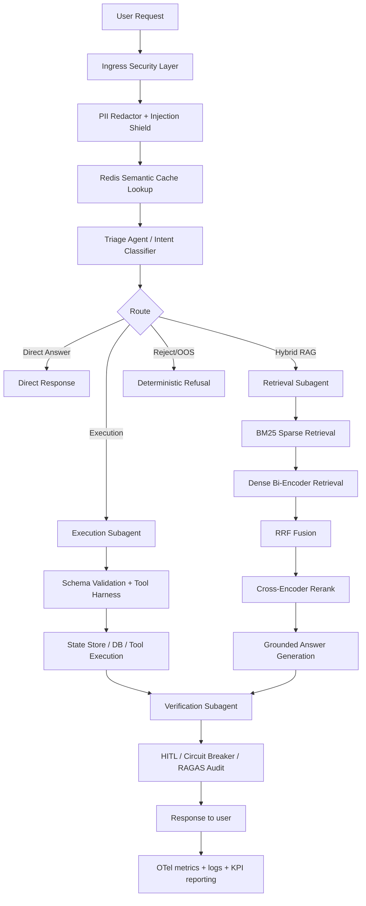

# Workflow Planner Sheet for the Hardened Enterprise Agent

## 1. Requirement Summary

The attached documents define a production-grade remediation and engineering blueprint for a fragile assistant that previously suffered from:

- hallucinated responses and weak grounding
- unbounded tool loops / infinite ReAct cycles
- cross-tenant cache leakage
- severe latency degradation under concurrency
- token inefficiency and unbounded context drift
- weak governance, security, and human approval gates

The target architecture is a hardened, MCP-enabled, plugin-extensible, enterprise-grade agentic system that must:

- sustain 50,000 concurrent virtual users
- keep end-to-end p95 latency under 450 ms and p99 under 600 ms
- block PII leakage and indirect prompt injection
- use a controlled 3-stage hybrid RAG pipeline
- route through strict tool validation and bounded execution loops
- pass 36 stage-level KPI gates before release

---

## 2. End-to-End Workflow Flow

---

## 3. Mandatory Delivery Sequence

### Phase 0 — Foundation and stack alignment
- Confirm enterprise stack and runtime contract
- Define MCP server boundaries and plugin lifecycle hooks
- Set base environment: Python 3.11 + FastAPI + Uvicorn
- Standardize transport: stdio for local MCP tools, Streamable HTTP/SSE for distributed services

Deliverables:
- MCP server inventory
- plugin registration blueprint
- environment and runtime contract

### Phase 1 — Pre-build design gate
- Author the required design documentation before any implementation code
- Define hard boundaries, non-goals, and user personas
- Record exact tool contracts, topology, SLA, FMEA, and ADRs

Required artifact:
- [design.md](design.md)

### Phase 2 — Workflow diagram gate
- Create an orchestration diagram that shows ingress, security, routing, RAG, control plane, verification, HITL, and telemetry
- Render in high DPI and expose through the app UI

Required artifact:
- [docs/workflow_orchestration.png](docs/workflow_orchestration.png)

### Phase 3 — Hybrid retrieval implementation
- Build 3-stage retrieval pipeline with strict latency budgets
- Add BM25 lexical retrieval
- Add dense semantic retrieval with FAISS / embedding store
- Add RRF fusion and cross-encoder reranking
- Add guardrail cutoff for abstention when confidence is low

Required implementation focus:
- mcp_servers/rag_server.py
- retrieval contracts
- confidence thresholding

### Phase 4 — Tool routing and control plane hardening
- Add Pydantic v2 validation
- Add deterministic regex repair for malformed identifiers
- Add RBAC and Tier gating
- Add bounded ReAct loop with max steps and time budgets
- Add idempotent circuit breaker and state mutation freeze logic

### Phase 5 — Context retention and security
- Add GoalAnchorBlock anchoring
- Compress observations before passing them to downstream reasoning
- Limit recursion and drift across turns
- Persist verified facts separately from hot transient memory

### Phase 6 — Triage and subagent topology
- Add high-speed triage classification
- Route to direct answer, hybrid RAG, execution, or reject path
- Separate retrieval, execution, and verification responsibilities
- Enforce read-only vs mutation boundaries

### Phase 7 — Observability and incident response
- Instrument all critical spans with OTel
- Export traces to collector / Grafana / Prometheus / Tempo
- Define alert triggers and mitigation runbooks

### Phase 8 — Validation and certification
- Run golden dataset evaluation and RAGAS checks
- Execute red-team adversarial tests
- Execute load and concurrency testing (50K VUs)
- Measure all 36 KPIs and fail the build if any gate fails

---

## 4. Gate-by-Gate Execution Checklist

### Gate 0: Enterprise Stack and MCP Standardization
- Python 3.11 + FastAPI + Uvicorn
- MCP JSON-RPC integration
- Plugin lifecycle interceptors
- State and cache separation

### Gate 1: Design.md Hard Gate
- System charter and scope
- tool contracts and validation rules
- topology and data flow
- latency budget and KPI matrix
- FMEA table
- ADRs

### Gate 2: Workflow Image Hard Gate
- diagram is generated before logic implementation
- diagram shows ingress, triage, retrieval, execution, verification, HITL, and observability

### Gate 3: Hybrid RAG and RAGAS
- Stage 1 BM25
- Stage 2 dense retrieval
- RRF fusion
- Stage 3 reranker
- golden set evaluation

### Gate 4: Tool Harness and Loop Control
- strict validation
- auth and RBAC checks
- deterministic regex repair
- bounded ReAct steps and time budgets

### Gate 5: Context Drift Control
- GoalAnchorBlock
- observation compression
- dual memory strategy

### Gate 6 & 7: Triage and subagents
- direct answer routing
- retrieval subagent
- execution subagent
- verification subagent

### Gate 8: Continuous evaluation and regression control
- RAGAS thresholds
- automated benchmarking
- release gate enforcement

### Gate 9: Reliability design patterns
- circuit breaker
- bulkhead isolation
- deterministic abstention
- async HITL gate

### Gate 10 & 11: Observability and runbooks
- full trace instrumentation
- incident remediation playbooks
- alert conditions

### Gate 12: 36-KPI certification and signoff
- all KPI gates pass in CI/CD and product validation

---

## 5. Risk and Control Matrix

| Risk Area | Core Problem | Required Control |
| --- | --- | --- |
| Hallucination | weak grounding and retrieval drift | hybrid RAG + rerank + verification subagent |
| Tool loops | unbounded ReAct reasoning | bounded state machine + max steps + circuit breaker |
| Cache leakage | tenant collision and shared cache | tenant-scoped hashing and isolation |
| Latency collapse | blocking I/O and bad batching | async workers, micro-batching, concurrency limits |
| PII leakage | obfuscation and prompt injection | pre-execution redaction and injection block |
| Untrusted actions | mutation without approval | HITL gate and RBAC |
| Token waste | raw context bloat | graph pruning + compression + citation-constrained generation |
| Poor observability | hidden failures | OTel traces, metrics, Grafana dashboards |

---

## 6. Recommended Implementation Order

1. Create [design.md](design.md)
2. Create workflow diagram and export PNG
3. Standardize MCP + plugin contracts
4. Build retrieval layer with latency and confidence gates
5. Build safety and validation harness
6. Build triage and routing logic
7. Add execution / verification subagents
8. Add OTel instrumentation and dashboards
9. Run benchmark suite and 36-KPI validation
10. Freeze release only after all gates pass

---

## 7. Definition of Done

The work is complete only when all of the following are true:

- design artifact is present and reviewed
- workflow diagram exists and is valid
- MCP and plugin architecture is standardized
- 3-stage RAG pipeline is implemented and performance-bounded
- security filters, PII redaction, and HITL controls are active
- observability and incident runbooks are in place
- benchmark suite passes with all production thresholds satisfied
- 36 KPI release matrix is green

---

## 8. Practical Implementation Note

This is not a feature build alone; it is a production hardening and governance program. The implementation should be treated as a staged release process, starting with design, then architecture, then guarded execution, then verification under load.
