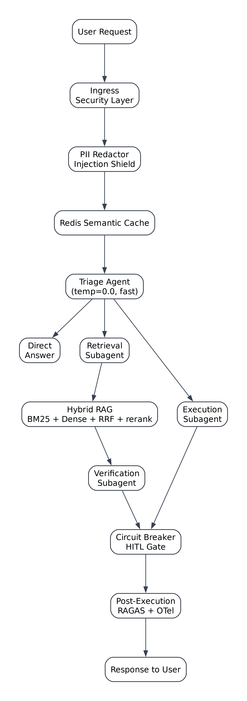

# design.md — "The Unreliable Assistant" → Enterprise-Grade Agentic Platform

**Status:** DRAFT v0.1 (first attempt, not yet locked) · **Gate:** 1 (pre-build) · **Source:** `Unreliable_Assistant_MidCheck_Enterprise_Blueprint_v2.docx`
**Companion artifact:** `docs/workflow_orchestration.png` (source: `docs/make_diagram.py`, `docs/workflow_orchestration.dot`)

---

## 0. Overview

### 0.1 Problem
The inherited prototype has five production-blocking defects:

| # | Defect | Root cause | Design answer |
|---|--------|-----------|---------------|
| P1 | Hallucinated facts | LLM answers without verified evidence | 3-stage hybrid RAG, cross-encoder confidence cut-off, deterministic abstention, NLI verification subagent, RAGAS gate |
| P2 | Runaway tool loops | Unbounded ReAct, no idempotency | Deterministic state machine, `max_iterations=5`, idempotent circuit breaker, UUIDv4 idempotency keys |
| P3 | Cross-user cache leaks | Shared / unscoped cache keys | `SHA256(tenant_id:user_id:norm_query)` keys, `tenant_id` in every query, concurrency probe (KPI-28) |
| P4 | Context drift | Tool output noise displaces intent | Immutable `GoalAnchorBlock`, observation compression ≤180 tokens, 3-turn window + durable `session_facts` |
| P5 | Latency collapse under load | Sync I/O, no batching, no isolation | Async stateless workers, bulkheads, dynamic micro-batching, semantic cache, vLLM continuous batching |

### 0.2 Solution in one paragraph
A multi-tenant, MCP-enabled agent platform. Requests enter through an API gateway, pass deterministic pre-execution plugins (PII redaction → injection shield), hit a tenant-isolated semantic cache, and are classified by a triage agent into four routes. Retrieval runs as a 3-stage hybrid pipeline (BM25 ∥ dense → RRF → cross-encoder) behind an MCP server. A bounded ReAct loop drives tools through a ToolExecutionHarness (validation, auto-repair, RBAC, idempotency) and a circuit breaker. State-mutating (Tier 3) actions freeze at an asynchronous HITL gate. Every answer is verified by an independent verification subagent and scored by RAGAS; every hop is traced with OpenTelemetry. 36 KPIs gate release.

### 0.3 Technology stack

| Layer | Choice | Binding | Justification |
|-------|--------|---------|---------------|
| Agent runtime / API | Python 3.11, FastAPI, Uvicorn (async), `uvloop` | MCP host client (`mcp.ClientSession`) | Non-blocking I/O; stateless → horizontal scale to 50K connections |
| Edge | NGINX / Envoy | — | TLS termination, rate limiting, connection fan-in, traceparent injection |
| Sparse retrieval | `rank-bm25` (BM25Okapi) + Porter stemmer, pre-tokenised inverted index | `mcp-hybrid-rag` | Exact lexical match for SKU/lot/regulation codes |
| Dense retrieval | `bge-large-en-v1.5` (ONNX) + FAISS HNSW | `mcp-hybrid-rag` | Semantic recall |
| Reranker | `bge-reranker-v2-m3` ONNX FP16, Triton / ONNX Runtime service | called by `mcp-hybrid-rag` | Cross-encoder precision, dynamic batching |
| State | PostgreSQL 16 + pgvector; Redis Cluster | `mcp-state-store` | ACID audit + sub-ms tenant-isolated cache |
| Token compression | Obsidian vault + Graphify graph | `mcp-graphify-vault` | 1–2 hop subgraph (~320 vs ~1,400 tokens) |
| Plugins | Pluggy entry-point registry | Pre / Post / PII / OTel / HITL | Hot-swappable deterministic interceptors outside LLM reasoning |
| Generation | vLLM or TensorRT-LLM (continuous batching, prefix caching) | `llm_pool` | High-throughput decode, prefix reuse of GoalAnchor/system prompt |
| Validation | Pydantic v2 (strict) | ToolExecutionHarness | Typed contracts, first-pass validation KPI |
| PII | Microsoft Presidio + regex/homoglyph normaliser | `pii_redactor` | ≥99.8% recall incl. obfuscation |
| Eval | RAGAS, NLI claim verifier, 250-Q golden set | `ragas_auditor` | Release gating |
| Observability | OpenTelemetry → Collector → Prometheus + Tempo + Grafana | `otel_exporter` | Full-trace, W3C `traceparent` |
| Load test | Grafana k6 + Apache JMeter (1 controller + 10 injectors) | — | Dual-tool validation at 50K VUs |
| Dev workbench | Streamlit (`app.py`, 6 tabs) | — | Live mid-check verification |
| Packaging / deploy | `uv`, Docker, Kubernetes (HPA, PodDisruptionBudgets) | — | Reproducible, autoscaled |

### 0.4 Architecture diagram


*Four zones: (1) Ingress & Security, (2) Triage & Subagent Routing, (3) MCP & 3-Stage RAG, (4) Control Plane & Egress; plus the OTel plane.*

---

## 1.1 System Charter & Hard Boundaries

### Purpose
Answer enterprise questions with verifiable, cited responses, and perform controlled workflow actions, for multiple tenants, at 200–600 ms end-to-end latency under 50,000 concurrent virtual users.

### In scope
- Question answering over tenant policies, SOPs and product catalogues (Obsidian atomic notes + indexed documents).
- Entity-aware lookups (SKU, LOT) and schema-validated form submissions / workflow transitions.
- Citation grounding, abstention on unanswerable queries, structured remediation on halted loops.
- Multi-tenant isolation, audit, observability, KPI scorecard, red-team harness, developer workbench.

### Non-goals (hard boundaries)
1. No autonomous clinical, financial or legal execution. Any Tier 3 (mutating) action requires an approved HITL record. This is enforced in code (KPI-19 = 100%), not by prompt.
2. No open-web browsing; the Execution subagent has no RAG or external web access.
3. No persistence of raw PII (only redacted forms and hashes).
4. No cross-tenant retrieval, caching or analytics.
5. No model fine-tuning pipeline (triage uses a pre-distilled classifier).
6. No LLM-authored security decisions: guardrails are deterministic plugins, `fail_closed`.

### Personas

| Persona | Needs | Key interactions |
|---------|-------|------------------|
| End user (tenant employee) | Fast, correct, cited answers; safe actions | `POST /api/v1/agent/query` |
| Tenant admin | Policy vault curation, tenant config, audit export | Vault ingest, audit API |
| HITL reviewer | Review/approve/reject Tier 3 mutations | Approval queue UI/API |
| SRE / on-call | Detect and mitigate latency, hallucination, MCP hangs | Grafana, runbooks, plugin toggles |
| ML / QA engineer | Evaluate RAG quality, tune hyper-parameters | RAG Lab, RAGAS suite |
| Red-teamer / security | Probe injection, PII smuggling, tenant leaks | Red-team runner |

### Functional requirements

| ID | Requirement |
|----|-------------|
| FR-01 | Accept query with `tenant_id`, `user_id`, `session_id`; reject if header tenant ≠ body tenant |
| FR-02 | Redact PII and block prompt injection before any model sees the text |
| FR-03 | Serve semantic-cache hits (cosine ≥ 0.92 under aggressive mode, tenant-scoped) |
| FR-04 | Triage to `DIRECT_ANSWER`, `HYBRID_RAG`, `TRANSACTION_EXEC`, `REJECT_OOS` |
| FR-05 | Retrieve with BM25 + dense → RRF → cross-encoder; return ≤4 cited chunks |
| FR-06 | Abstain deterministically when top rerank score < threshold (0.42) |
| FR-07 | Validate and auto-repair tool arguments; enforce RBAC tier and idempotency |
| FR-08 | Bound every loop (5 iterations, 120 ms/step, 450 ms total) and trip breaker on repeated identical failure |
| FR-09 | Freeze Tier 3 actions as `PENDING_APPROVAL` until reviewer decision |
| FR-10 | Verify every draft (claim→chunk NLI) and veto ungrounded output |
| FR-11 | Emit hash-chained audit events and OTel spans for every hop |
| FR-12 | Expose the 36-KPI scorecard and run red-team / load suites from CI and Streamlit |

---

## 1.2 MCP Tool & Data Contracts

All tools are MCP tools over JSON-RPC 2.0. Local workers use stdio; distributed services use Streamable HTTP/SSE. Server manifests are signed and verified at startup.

### 1.2.1 Shared types (Pydantic v2, `strict=True`, `extra="forbid"`)

```python
from typing import Annotated, Literal
from uuid import UUID
from pydantic import BaseModel, ConfigDict, Field, StringConstraints

TenantId  = Annotated[str, StringConstraints(pattern=r"^tenant_[A-Za-z0-9_-]{1,64}$")]
UserId    = Annotated[str, StringConstraints(pattern=r"^user_[A-Za-z0-9_-]{1,64}$")]
SessionId = Annotated[str, StringConstraints(pattern=r"^[0-9a-f]{8}-[0-9a-f]{4}-4[0-9a-f]{3}-[89ab][0-9a-f]{3}-[0-9a-f]{12}$")]
SKU       = Annotated[str, StringConstraints(pattern=r"^SKU-\d{3,6}$")]
LOT       = Annotated[str, StringConstraints(pattern=r"^LOT-\d{5}$")]
ChunkId   = Annotated[str, StringConstraints(pattern=r"^[a-f0-9]{16,64}$")]
RiskTier  = Literal["TIER_1_READ", "TIER_2_COMPUTE", "TIER_3_MUTATE"]

class Base(BaseModel):
    model_config = ConfigDict(strict=True, extra="forbid", frozen=True)

class AgentQueryRequest(Base):
    tenant_id: TenantId
    user_id: UserId
    session_id: SessionId | None = None
    query: Annotated[str, StringConstraints(min_length=1, max_length=4000)]

class AgentQueryResponse(Base):
    tenant_id: TenantId
    answer: str
    citations: list["Citation"]
    route: Literal["DIRECT_ANSWER", "HYBRID_RAG", "TRANSACTION_EXEC", "REJECT_OOS"]
    status: Literal["OK", "ABSTAINED", "PENDING_APPROVAL", "HALTED_BREAKER", "REFUSED"]
    faithfulness: float | None = Field(default=None, ge=0, le=1)
    trace_id: str

class Citation(Base):
    chunk_id: ChunkId
    source_uri: str
    score: float = Field(ge=0, le=1)
```

### 1.2.2 `mcp-hybrid-rag` (stdio, timeout 150 ms, pool 64)

| Item | Contract |
|------|----------|
| Tool `hybrid_retrieve` | in: `HybridRetrieveIn` → out: `HybridRetrieveOut` |
| Resource `rag://chunks/{id}` | returns chunk text + metadata; `{id}` must match `ChunkId`; tenant enforced from session context |
| Tier | `TIER_1_READ` (read-only; subagent cannot call mutating tools) |

```python
class HybridRetrieveIn(Base):
    tenant_id: TenantId
    query: Annotated[str, StringConstraints(min_length=1, max_length=2000)]
    bm25_top_k: int = Field(default=50, ge=1, le=100)
    dense_top_k: int = Field(default=50, ge=1, le=100)
    rrf_k: int = Field(default=60, ge=1, le=200)
    pool: int = Field(default=40, ge=4, le=100)
    rerank_k: int = Field(default=4, ge=1, le=10)
    threshold: float = Field(default=0.42, ge=0, le=1)
    idempotency_key: UUID

class ScoredChunk(Base):
    chunk_id: ChunkId; text: str
    bm25: float | None; cosine: float | None; rrf_rank: int | None
    rerank_score: float = Field(ge=0, le=1)

class HybridRetrieveOut(Base):
    chunks: list[ScoredChunk]
    top_score: float
    abstain: bool
    stage_ms: dict[Literal["bm25","dense","rrf","rerank"], float]
```

### 1.2.3 `mcp-state-store` (Streamable HTTP, pool 200)

| Tool | Tier | Input (key fields) | Output |
|------|------|--------------------|--------|
| `get_session_facts` | T1 | `tenant_id, session_id` | `list[Fact]` |
| `put_session_fact` | T2 | `tenant_id, session_id, fact (verified only), source_chunk_id` | `fact_id` |
| `cache_lookup` | T1 | `tenant_id, user_id, norm_query_hash` | `hit, payload?` |
| `cache_store` | T2 | key, payload, `ttl_s = 300 ± 45 jitter` | `ok` |
| `submit_form` | T3 | `tenant_id, form_id, payload, idempotency_key` | `PENDING_APPROVAL` record id |
| `transition_workflow` | T3 | `tenant_id, entity (SKU/LOT), from_state, to_state, idempotency_key` | `PENDING_APPROVAL` record id |
| `append_audit` | T2 (verification subagent only) | event payload | `event_hash` |

Tier 3 tools never mutate directly: they write `PENDING_APPROVAL`; a separate `approve_action` endpoint (reviewer role only) performs the commit.

### 1.2.4 `mcp-graphify-vault` (stdio)

| Tool | Input | Output |
|------|-------|--------|
| `resolve_anchor` | `tenant_id, query` | `node_id` or `null` |
| `expand_subgraph` | `node_id, depth ≤ 2, token_budget (default 320)` | pruned nodes + edges + text |

### 1.2.5 ToolExecutionHarness (mandatory path for every tool call)

1. Pydantic v2 strict validation → on failure go to step 2.
2. Deterministic regex auto-repair (no LLM), e.g. `SKU99 → SKU-099`, `lot 44 → LOT-00044`; re-validate once. Repair is logged for KPI-15.
3. RBAC tier check: caller role vs. tool tier (`T1 < T2 < T3`); subagent allow-list enforced (Retrieval: T1 only; Execution: state-store only; Verification: audit only).
4. Idempotency: `idempotency_key` must be UUIDv4; duplicates return the stored result; missing key on T2/T3 → reject.
5. Dispatch through the circuit breaker keyed by `(tool_name, canonical_args_hash)`.

### 1.2.6 Error codes (JSON-RPC `error.code`)

| Code | Name | Meaning | Retry | User-facing result |
|------|------|---------|-------|--------------------|
| -32700 | PARSE_ERROR | Invalid JSON | no | 400 |
| -32600 | INVALID_REQUEST | Malformed JSON-RPC | no | 400 |
| -32601 | METHOD_NOT_FOUND | Unknown tool | no | 400 |
| -32602 | INVALID_PARAMS | Failed Pydantic validation after repair | no | structured remediation |
| -32001 | TENANT_MISMATCH | Header/body/session tenant differ | no | 403 |
| -32002 | RBAC_DENIED | Tier/role violation | no | 403 |
| -32003 | PII_BLOCKED | PII plugin failed closed | no | 422 |
| -32004 | INJECTION_BLOCKED | Injection shield tripped | no | 422 |
| -32005 | MCP_TIMEOUT | > 150 ms (rag) / per-step 120 ms | yes (≤1, jittered) | degraded answer |
| -32006 | BREAKER_OPEN | Circuit breaker open for `(tool,args)` | no | `HALTED_BREAKER` + remediation |
| -32007 | IDEMPOTENCY_CONFLICT | Same key, different args | no | 409 |
| -32008 | PENDING_APPROVAL | Tier 3 awaiting reviewer | n/a | 202 |
| -32009 | LOOP_BUDGET_EXCEEDED | 5 iterations / 450 ms | no | `HALTED` + partial answer |
| -32010 | UNGROUNDED_DRAFT | Verification vetoed | yes (1 re-ground) | abstain |
| -32011 | UPSTREAM_RATE_LIMITED | LLM 429 | yes (backoff, fallback model) | degraded / queue |

HTTP mapping: validation → 400/422, authz → 403, conflict → 409, HITL → 202, overload → 429 with `Retry-After`, server fault → 5xx (counted in KPI-34).

### 1.2.7 Config (`mcp_config.json`) — as specified in the blueprint
Servers `hybrid-rag` (stdio, 150 ms), `state-store` (streamable-http, pool 200), `graphify-vault` (stdio). Plugins: `pii_redactor` (PRE, p10, fail-closed), `injection_shield` (PRE, p20, fail-closed), `circuit_breaker` (TOOL_DISPATCH, `max_identical_calls=2`), `ragas_auditor` (POST, `min_faithfulness=0.92`), `otel_exporter` (ALL_SPANS → `:4317`). Plugin order is by `priority`; fail-closed plugins reject the request on plugin error.

---

## 1.3 Distributed Topology & Data Flow

```text
Client / UI
   |
   v
API Gateway / FastAPI
   |
   +--> Pre-Execution Plugins
   |      - PII Redactor
   |      - Injection Shield
   |      - Request Normalizer
   |
   +--> Redis Semantic Cache
   |
   +--> Triage Agent
          |
          +--> Direct Answer
          +--> Retrieval Subagent
          |      +--> mcp-hybrid-rag
          |             +--> BM25
          |             +--> Dense Bi-Encoder
          |             +--> RRF Fusion
          |             +--> Cross-Encoder Rerank
          |
          +--> Execution Subagent
          |      +--> mcp-state-store
          |
          +--> Verification Subagent
                 +--> RAGAS / OTel / Audit Logs

PostgreSQL stores session facts, approvals, and audit records.
Redis stores tenant-isolated semantic cache data.
ONNX reranker and vector retrieval run near the retrieval layer.
```

### Data flow principles
- Every request is validated before any model call.
- Retrieval is read-only and evidence-backed.
- Execution is gated and auditable.
- Verification is independent from generation.
- Cache keys are tenant-scoped and hash-based.

---

## 1.4 End-to-End Latency Budget (200–600 ms)

The system must keep p95 latency under 450 ms and p99 under 600 ms under 50,000 concurrent virtual users.

### Target budget
- ingress and normalization: < 15 ms
- triage classification: < 25 ms
- BM25 retrieval: < 12 ms
- dense retrieval: < 25 ms
- RRF fusion: < 3 ms
- rerank: < 45 ms
- generation and verification: < 150–200 ms
- safety and observability overhead: < 50 ms

### Hard constraint
If the total path exceeds budget, the system falls back to semantic cache, deterministic abstention, or a fail-safe degraded path rather than hallucinating an answer.

---

## 1.5 KPI & SLA Gate Matrix

The build must pass all 36 stage-level KPIs across ingress, retrieval, agent, loop, generation, token optimization, scale, and load.

| Stage | KPI examples | Target |
|------|--------------|--------|
| Ingress & Triage | PII redaction recall | ≥99.8% |
| Ingress & Triage | Prompt injection block rate | ≥99.5% |
| Ingress & Triage | Triage routing accuracy | ≥97.0% |
| Hybrid Retrieval | BM25 latency p95 | ≤12 ms |
| Hybrid Retrieval | Dense latency p95 | ≤25 ms |
| Hybrid Retrieval | Rerank latency p95 | ≤45 ms |
| Hybrid Retrieval | Context recall@50 | ≥0.92 |
| Hybrid Retrieval | Context precision@4 | ≥0.88 |
| Agent & Loop | Infinite loop escape rate | 100% |
| Agent & Loop | Mean ReAct steps | ≤2.2 |
| Generation / RAGAS | Faithfulness | ≥0.92 |
| Generation / RAGAS | Answer relevancy | ≥0.90 |
| Scale / Load | 50K VU throughput | ≥8,500 RPS |
| Scale / Load | p95 latency | ≤450 ms |
| Scale / Load | p99 latency | ≤600 ms |

---

## 1.6 Failure Mode & Effects Analysis (FMEA)

| Failure Mode | Impact | Detection | Fallback |
| --- | --- | --- | --- |
| Redis outage | cache misses and degraded latency | health checks and span alerts | fail over to read-only index |
| MCP server crash | retrieval or state loss | heartbeat and timeout metrics | fail closed and degrade answer path |
| Reranker timeout | weak grounding | cross-encoder latency alert | abstention or semantic fallback |
| LLM 429 / overload | generation failure | rate-limit detection | retry with jitter + fallback |
| Cache collision | cross-user leak | tenant hash validation | reject and rekey |
| Tool loop | runaway execution | step counter + circuit breaker | halt + require HITL |
| Injection payload | unsafe response | classifier + shield | reject and log |
| Malformed tool args | execution failure | Pydantic validation + repair | auto-repair or reject |
| PII smuggling | policy breach | redactor + regex detection | redact and fail closed |
| Compute bottleneck | latency spike | bulkhead and queue metrics | isolate pool and reduce concurrency |
| Goal drift | off-topic output | GoalAnchorBlock verification | reset goal and re-plan |
| Schema mismatch | broken execution | pre-run validation | return structured error |

---

## 1.7 Architecture Decision Records (ADRs)

### ADR-01: Hybrid retrieval weights
Use BM25 + dense embedding + RRF + reranker to maximize recall and precision while keeping latency within the budget.

### ADR-02: ONNX quantization strategy
Use ONNX FP16/INT8 quantization and dynamic batching to reduce inference latency without unacceptable quality loss.

### ADR-03: Redis key isolation
Hash keys as `SHA256(tenant_id:user_id:norm_query)` to prevent cross-tenant or cross-user cache leakage.

### ADR-04: Bounded ReAct control
Use a strict state machine with `max_iterations=5`, `per_step_timeout=120 ms`, and `total_loop_budget=450 ms` to eliminate runaway behavior.

### ADR-05: Human approval for Tier 3 mutations
Any state-changing or sensitive transaction must freeze as `PENDING_APPROVAL` until an authorized reviewer approves it.

### ADR-06: Deterministic abstention
When retrieval confidence is below threshold, the system abstains rather than guessing. This reduces hallucination risk and token waste.

---

## 2. Gate 1: Mandatory Pre-Build Artifact (`design.md`)

This file is the mandatory pre-build artifact required before implementation begins. It defines the system charter, tool contracts, topology, latency budget, KPI matrix, FMEA, and ADRs.

### 2.1 Required sections checklist
1. System Charter & Hard Boundaries
2. MCP Tool & Data Contracts
3. Distributed Topology & Data Flow
4. End-to-End Latency Budget
5. KPI & SLA Gate Matrix
6. FMEA
7. ADRs

### 2.2 Design constraints
- No implementation code before the design is authored and reviewed.
- All security decisions must be fail-closed.
- All state-changing actions must be gated by HITL.
- All retrieval must be evidence-based and citation-grounded.
- All performance and audit KPIs must be measurable in CI/CD and UI dashboards.

---

## 3. Implementation intent

This project is not just a feature build; it is a production-grade hardening and governance exercise. The implementation sequence is:

1. Lock the design artifact.
2. Generate the workflow diagram and export the PNG.
3. Standardize MCP servers and plugin registry.
4. Implement the retrieval pipeline with latency budgets.
5. Add tool validation, RBAC, idempotency, and loop gates.
6. Add context anchoring, compression, and fact persistence.
7. Add triage and subagent topology.
8. Add observability, incident runbooks, and dashboard metrics.
9. Validate the system with golden dataset, red-team harness, and 50K-VU load tests.
10. Release only when all 36 KPIs pass.

---

## 4. Final design outcome

The final architecture is a secure enterprise-grade assistant that emphasizes grounded retrieval, bounded tool execution, user and tenant isolation, human approval for sensitive operations, and measurable release quality. The system behaves as a trusted operational layer rather than an unconstrained autonomous agent.
